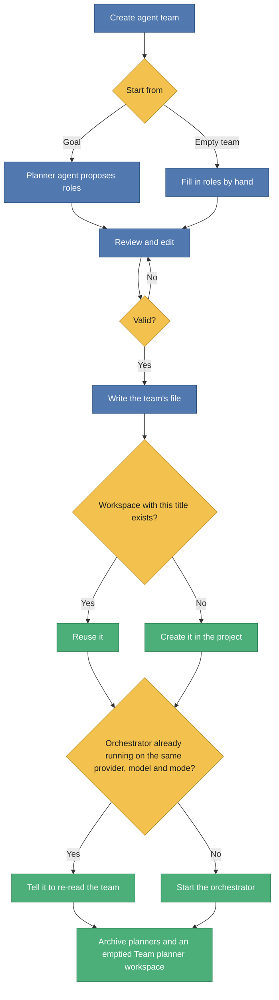
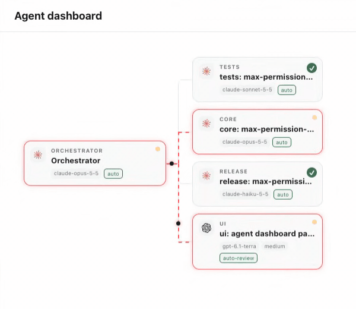

# Paseo Agent Team

A [Paseo](https://paseo.sh) plugin for project-scoped agent teams. Each role in a project gets its own workspace and its own provider and model, and an orchestrator agent hands work to them.

For example, in a game project, design work can go to Codex, sound to Antigravity and gameplay code to Claude. You describe the goal once, review the proposed team, and from then on you talk to one orchestrator.


## Concepts

| Term | Meaning |
| --- | --- |
| **Project** | A repository registered in Paseo. A team belongs to one project. |
| **Workspace** | A Paseo workspace in that project. Each role works in its own workspace. |
| **Role** | A name plus the provider, model, folders and instructions for one workspace, for example `design → codex/gpt-6.1-sol`. |
| **Orchestrator** | The agent that reads the team and delegates each part of a request to the role that owns it. |
| **Team definition** | One file per team in `.agents/teams/` at the project root, or the single file `.agents/team.json`. It is the source of truth for the team and is meant to be committed. |

The team lives in the repository rather than in plugin settings, so it is shared through git and readable by agents. Workspaces are matched by title, not by ID, so the same file works on any machine.

A project can run several teams, one per workspace. A team belongs to the workspace its orchestrator runs in, and the **Agent team** panel of a workspace shows that workspace's team. Teams never share a workspace: the orchestrator's workspace and every role's own workspace belong to one team only.

## Requirements

- Paseo 0.13.0 or later, with **Settings → Plugins → Enable plugins** turned on.
- At least one provider ready on the host. Check with `paseo provider ls` and `paseo provider models <provider>`.
- Paseo tools available to agents (the default). The orchestrator uses them, or the `paseo` CLI, to start and message other agents.

## Install

From a local checkout:

```bash
git clone https://github.com/gyuha/paseo-agent-team.git
cd paseo-agent-team
npm install
paseo plugin install "$(pwd)"
paseo plugin ls   # paseo-agent-team should be "running"
```

Or paste the absolute path of the checkout into **Settings → Plugins → Plugin source** in Paseo. Reload the Paseo window afterwards so the app picks up the plugin's UI.

## Usage

### 1. Create a team

Open a workspace in the project you want a team for, then:

1. Open the Command Center and run **Create agent team**, or open the **Agent team** workspace panel. A team created from a workspace runs its orchestrator in that workspace.

   Without an open workspace, for example on the New workspace screen, use **Create agent team** in the sidebar instead. It lists the projects that have no team yet; pick one and continue with step 2. The planner starts in an existing workspace of that project, or in a new `Team planner` workspace if it has none. After **Apply** you are taken to the orchestrator's workspace. The sidebar item is hidden once every project has a team.
2. Describe the goal, for example `2D platformer game`, and press **Propose a team**. A planner agent looks at the repository and proposes roles using only the providers and models that are ready on this host. It takes a minute or two; **Open planner** shows its chat.
3. Review the proposal. You can rename roles and workspaces, pick another provider or model, set the folders each role owns, edit instructions, and add or remove roles. To have AI add a role, describe a role in a sentence or two under the role list and press **Add role with AI**: a planner agent proposes one role (name, workspace, provider and model, folders, instructions) that avoids the existing roles' names and folders, and appends it for you to review. One role is created at a time, and the planner is archived with the others on **Apply**. Problems such as an unknown model are shown in red, and **Apply** stays disabled until they are fixed.
4. Press **Apply**.

To skip the planner, press **Start with an empty team** and fill in the roles yourself.

Applying does four things in order. It writes the team's file (and, when needed, the `paseo run` allow rule described under Limitations), makes sure every role that has its own workspace has one, starts the orchestrator, and cleans up the planners. A new team is written to `.agents/teams/<orchestrator workspace>.json`; a team that already has a file, including `.agents/team.json`, keeps it. An existing workspace with the same title is reused, and a missing one is created in the project. Applying again tells the team's running orchestrator to re-read the team instead of starting a second one; none is archived. Apply refuses a team that uses a workspace another team of the project already uses. A role whose workspace is empty gets none and runs in the orchestrator's workspace. If a role is switched from its own workspace to shared, Apply leaves the old workspace and its sessions alone; archive them yourself if you no longer need them.

Cleanup archives every planner agent left in the project, including ones from proposals you cancelled. A `Team planner` workspace is archived too, but only when the team doesn't use it and no other agent is left in it. If cleanup fails, the team is still applied and the failure is shown as a warning.



### 2. Work through the orchestrator

Press **Open orchestrator** after applying, or find the agent titled **Orchestrator** in the orchestrator workspace. Talk to it in plain language:

> Redesign the title screen and add jump and coin sounds. Report back when both are done.

The orchestrator splits the request by role, starts each role's agent in that role's workspace (the orchestrator's workspace for a role without its own) with that role's provider and model, and continues with an existing agent there, found by its `role=<name>` label, instead of starting a new one. It waits for the results and summarizes what each role did. The role agents show up under their workspaces in Paseo's sidebar, where you can watch them or talk to them directly.

```
Your request → Orchestrator splits it by role → each role's agent works in its own workspace → Orchestrator waits and reports
```

### 3. Change the team

Either open the **Agent team** panel in the team's orchestrator workspace, press **Edit**, change the team and press **Apply**, or edit the team's file directly and press **Apply again** in the panel. The panel shows the file's path. The panel shows the current team and flags any provider or model the host can't run.

### 4. Watch the agents

The **Agent dashboard** workspace panel (**에이전트 대시보드** in Korean) shows the project's agents as a tree. An agent started by another agent appears under that agent, so role agents started by the orchestrator sit under it. Agents with no parent are roots, and roots without children are listed under **Solo agents**.



The capture shows the orchestrator as the root card, with four role agents under it. `core` and `ui` are running: their cards glow softly, and command packets travel from the orchestrator along the path to them, flashing each card on arrival. `tests` and `release` have finished and show ✓.

Each card shows the provider logo, the role or caption, the title, and the model, effort (thinking option) and permission mode chips. When an agent has no effort set, its effort chip shows the model's default effort from the provider, dimmed. The badge is **!** when the agent is waiting for a permission or has failed, an amber pulsing dot while it runs, and ✓ when it has finished. Lines to running agents turn into animated red dashes with moving signal dots. An agent that is not running itself but has a running agent below it, such as an orchestrator waiting on its role agents, gets an amber border without the glow. Press a card to open that agent. Closed and archived agents are hidden unless **Show closed** is on.

### 5. Run another team in another workspace

Open the **Agent team** panel in a workspace that has no team yet and create one as in step 1. Its orchestrator runs in that workspace, and the team is written to its own file in `.agents/teams/`. Each team's orchestrator reads only its own file, so the teams don't change each other. The panel of a workspace that is a role's own workspace in another team says so instead of offering to create a team.

```
Workspace A panel → team A (.agents/teams/a.json) → orchestrator in A
Workspace B panel → team B (.agents/teams/b.json) → orchestrator in B
```

## Team definition format

`.agents/teams/<orchestrator workspace>.json`, or `.agents/team.json`:

```json
{
  "version": 1,
  "goal": "2D platformer game",
  "orchestrator": { "workspace": "orchestrator", "provider": "claude", "model": "claude-opus-5-5" },
  "roles": [
    {
      "name": "design",
      "workspace": "design",
      "provider": "codex",
      "model": "gpt-6.1-sol",
      "folders": ["src/ui", "assets/images"],
      "instructions": "Owns the UI and all visual assets."
    },
    {
      "name": "sound",
      "workspace": "sound",
      "provider": "antigravity",
      "model": "gemini-4-argon-high",
      "folders": ["assets/audio"],
      "instructions": "Sound effects and music."
    }
  ]
}
```

| Field | Required | Notes |
| --- | --- | --- |
| `version` | yes | Always `1`. |
| `goal` | no | What the team is for. Shown to the orchestrator. |
| `orchestrator.workspace` | yes | Workspace title for the orchestrator. The team belongs to this workspace, and no two teams of a project may use the same one. |
| `orchestrator.provider`, `.model` | yes | Provider ID and model ID, as listed by `paseo provider models <provider>`. |
| `roles[]` | yes | At least one role. |
| `roles[].name` | yes | Unique, case-insensitive. |
| `roles[].workspace` | no | Workspace title. Empty means the role shares the orchestrator's workspace, and its sessions are found there by the `role=<name>` label. A title set here may be used only once, including the orchestrator's, and not by another team of the project. New proposals and roles added in the editor leave it empty. |
| `roles[].provider`, `.model` | yes | Must be ready on the host when you apply. |
| `roles[].folders` | no | Folders the role owns. Empty means no limit. The orchestrator keeps roles inside them and runs overlapping work one after another. |
| `roles[].instructions` | no | Extra guidance for that role. |

## Language

The plugin's UI follows Paseo's app language. English is the default and Korean is included. Error messages from the daemon side are in English.

## Limitations

- A role's model applies to agents started by the orchestrator or this plugin. Agents you start yourself in a role's workspace from Paseo's own UI still use whatever model you pick there.
- A team's file is matched to its workspace by `orchestrator.workspace`. Renaming that workspace in Paseo or in the file detaches the team from it until the two match again. Workspaces for roles of other teams are not offered to the planner, so a proposal can still collide with them; the panel flags the collision before Apply.
- A role without its own workspace runs its sessions in the orchestrator's workspace, so its agents sit beside the orchestrator there. Switching a role from its own workspace to shared does not archive the old workspace or its sessions.
- Role workspaces are local workspaces of the same checkout, so they share one folder. Keep roles to separate folders, or have the orchestrator run overlapping work in sequence.
- The planner, the orchestrator and the role agents start in the provider's reviewed auto mode when it has one: Codex's Auto-review (`auto-review`), otherwise an `auto` mode such as Claude's Auto mode (`auto`). Only a provider with neither uses its unattended mode: the one marked unattended, otherwise the one Paseo marks dangerous, such as Antigravity's Full access. Otherwise they use the default mode. The unattended mode keeps running without asking you; Auto mode and Auto-review route permission requests through an automatic reviewer instead. The planner is told not to change files but is not technically prevented from doing so.
- An orchestrator in Claude's Auto mode has its tool calls checked by Claude's automatic reviewer, which can deny starting an agent in an unattended mode such as Antigravity's `full-access`, the only mode Antigravity has. The orchestrator is told to use each role's mode as given, never to swap in another mode or provider, and to report a denied start to you instead. So when the orchestrator runs on Claude and a role's chosen mode is unattended, Apply adds the narrow allow rule `Bash(paseo run *)` to the project's `.claude/settings.local.json`, which Auto mode honours without asking its reviewer. This lets the orchestrator start any agent with `paseo run` without review. Remove the rule to undo it. Claude Code ignores that file in git only when Claude Code itself created it, so check that you don't commit it. An orchestrator that was already running may need to be restarted to pick up the rule.
- Paseo's sidebar puts a workspace it hasn't seen yet at the top of its project, so a new team lists the orchestrator first and the roles in team order. A workspace you already have keeps its place, so after applying a changed team, workspaces created for new roles appear above the orchestrator; drag them into place. The plugin cannot set the sidebar order.
- Very long workspace or agent lists are read as a single page. On hosts with a lot of workspaces, an existing workspace could be missed and created again, and the agent dashboard can miss agents beyond that page.
- On Paseo hosts without client navigation, the agent dashboard cards are not pressable.

## Development

```bash
npm install            # .npmrc sets legacy-peer-deps, which works around an npm 10.9 resolver crash
npm run typecheck
npm test               # unit tests
PASEO_E2E=1 npx vitest run tests/daemon.e2e.test.ts   # against the local daemon
paseo plugin reload paseo-agent-team
paseo plugin logs paseo-agent-team
```

The end-to-end test starts real agents (a planner and an orchestrator) in a temporary project under the system temp folder, so it costs tokens. It connects to `ws://127.0.0.1:6767/ws` unless `PASEO_URL` is set.

Layout: `shared/` holds the team schema, validation, prompts, RPC contracts and UI text, and is compiled into both sides. `server/` holds the daemon-side RPC handlers. `client/` holds the panel. `tests/` holds the Vitest suites.
