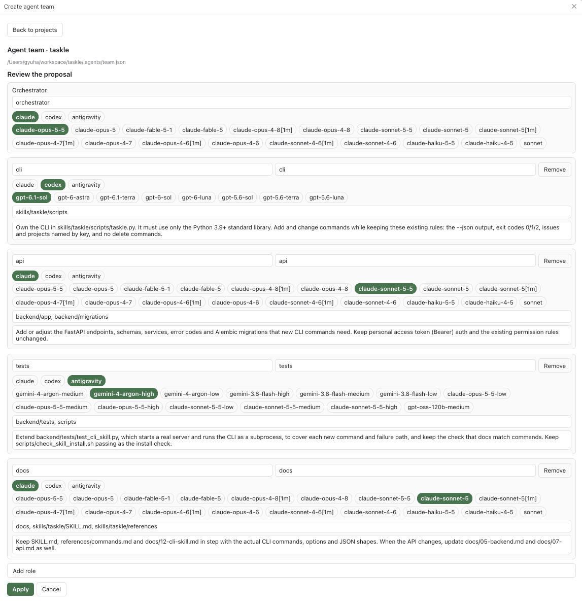
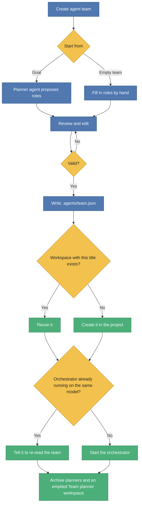

# Paseo Agent Team

A [Paseo](https://paseo.sh) plugin for project-scoped agent teams. Each role in a project gets its own workspace and its own provider and model, and an orchestrator agent hands work to them.

For example, in a game project, design work can go to Codex, sound to Antigravity and gameplay code to Claude. You describe the goal once, review the proposed team, and from then on you talk to one orchestrator.



## Concepts

| Term | Meaning |
| --- | --- |
| **Project** | A repository registered in Paseo. A team belongs to one project. |
| **Workspace** | A Paseo workspace in that project. Each role works in its own workspace. |
| **Role** | A name plus the provider, model, folders and instructions for one workspace, for example `design → codex/gpt-6.1-sol`. |
| **Orchestrator** | The agent that reads the team and delegates each part of a request to the role that owns it. |
| **Team definition** | The file `.agents/team.json` at the project root. It is the source of truth for the team and is meant to be committed. |

The team lives in the repository rather than in plugin settings, so it is shared through git and readable by agents. Workspaces are matched by title, not by ID, so the same file works on any machine.

## Requirements

- Paseo 0.13.0 or later, with **Settings → Plugins → Enable plugins** turned on.
- At least one provider ready on the host. Check with `paseo provider ls` and `paseo provider models <provider>`.
- Paseo tools available to agents (the default). The orchestrator uses them, or the `paseo` CLI, to start and message other agents.

## Install

From a local checkout:

```bash
git clone https://github.com/gyuha/paseo-agent-team.git
cd paseo-agent-team
npm install
paseo plugin install "$(pwd)"
paseo plugin ls   # paseo-agent-team should be "running"
```

Or paste the absolute path of the checkout into **Settings → Plugins → Plugin source** in Paseo. Reload the Paseo window afterwards so the app picks up the plugin's UI.

## Usage

### 1. Create a team

Open a workspace in the project you want a team for, then:

1. Open the Command Center and run **Create agent team**, or open the **Agent team** workspace panel.

   Without an open workspace, for example on the New workspace screen, use **Create agent team** in the sidebar instead. It lists the projects that have no `.agents/team.json` yet; pick one and continue with step 2. The planner starts in an existing workspace of that project, or in a new `Team planner` workspace if it has none. After **Apply** you are taken to the orchestrator's workspace. The sidebar item is hidden once every project has a team.
2. Describe the goal, for example `2D platformer game`, and press **Propose a team**. A planner agent looks at the repository and proposes roles using only the providers and models that are ready on this host. It takes a minute or two; **Open planner** shows its chat.
3. Review the proposal. You can rename roles and workspaces, pick another provider or model, set the folders each role owns, edit instructions, and add or remove roles. Problems such as an unknown model are shown in red, and **Apply** stays disabled until they are fixed.
4. Press **Apply**.

To skip the planner, press **Start with an empty team** and fill in the roles yourself.

Applying does four things in order. It writes `.agents/team.json`, makes sure every role has a workspace, starts the orchestrator, and cleans up the planners. An existing workspace with the same title is reused, and a missing one is created in the project. If an orchestrator is already running in its workspace on the same provider and model, it is kept and told to re-read the team instead of starting a second one.

Cleanup archives every planner agent left in the project, including ones from proposals you cancelled. A `Team planner` workspace is archived too, but only when the team doesn't use it and no other agent is left in it. If cleanup fails, the team is still applied and the failure is shown as a warning.



### 2. Work through the orchestrator

Press **Open orchestrator** after applying, or find the agent titled **Orchestrator** in the orchestrator workspace. Talk to it in plain language:

> Redesign the title screen and add jump and coin sounds. Report back when both are done.

The orchestrator splits the request by role, starts each role's agent in that role's workspace with that role's provider and model, and continues with an existing agent there instead of starting a new one. It waits for the results and summarizes what each role did. The role agents show up under their workspaces in Paseo's sidebar, where you can watch them or talk to them directly.

```
Your request → Orchestrator splits it by role → each role's agent works in its own workspace → Orchestrator waits and reports
```

### 3. Change the team

Either open the **Agent team** panel, press **Edit**, change the team and press **Apply**, or edit `.agents/team.json` directly and press **Apply again** in the panel. The panel shows the current team and flags any provider or model the host can't run.

## Team definition format

`.agents/team.json`:

```json
{
  "version": 1,
  "goal": "2D platformer game",
  "orchestrator": { "workspace": "orchestrator", "provider": "claude", "model": "claude-opus-5-5" },
  "roles": [
    {
      "name": "design",
      "workspace": "design",
      "provider": "codex",
      "model": "gpt-6.1-sol",
      "folders": ["src/ui", "assets/images"],
      "instructions": "Owns the UI and all visual assets."
    },
    {
      "name": "sound",
      "workspace": "sound",
      "provider": "antigravity",
      "model": "gemini-4-argon-high",
      "folders": ["assets/audio"],
      "instructions": "Sound effects and music."
    }
  ]
}
```

| Field | Required | Notes |
| --- | --- | --- |
| `version` | yes | Always `1`. |
| `goal` | no | What the team is for. Shown to the orchestrator. |
| `orchestrator.workspace` | yes | Workspace title for the orchestrator. |
| `orchestrator.provider`, `.model` | yes | Provider ID and model ID, as listed by `paseo provider models <provider>`. |
| `roles[]` | yes | At least one role. |
| `roles[].name` | yes | Unique, case-insensitive. |
| `roles[].workspace` | yes | Workspace title. Each workspace, including the orchestrator's, may be used only once. |
| `roles[].provider`, `.model` | yes | Must be ready on the host when you apply. |
| `roles[].folders` | no | Folders the role owns. Empty means no limit. The orchestrator keeps roles inside them and runs overlapping work one after another. |
| `roles[].instructions` | no | Extra guidance for that role. |

## Language

The plugin's UI follows Paseo's app language. English is the default and Korean is included. Error messages from the daemon side are in English.

## Limitations

- A role's model applies to agents started by the orchestrator or this plugin. Agents you start yourself in a role's workspace from Paseo's own UI still use whatever model you pick there.
- Role workspaces are local workspaces of the same checkout, so they share one folder. Keep roles to separate folders, or have the orchestrator run overlapping work in sequence.
- The planner, the orchestrator and the role agents start in Auto mode when their provider offers one (Claude does); other providers use their default mode. The planner is told not to change files but is not technically prevented from doing so.
- Very long workspace or agent lists are read as a single page. On hosts with a lot of workspaces, an existing workspace could be missed and created again.

## Development

```bash
npm install            # .npmrc sets legacy-peer-deps, which works around an npm 10.9 resolver crash
npm run typecheck
npm test               # unit tests
PASEO_E2E=1 npx vitest run tests/daemon.e2e.test.ts   # against the local daemon
paseo plugin reload paseo-agent-team
paseo plugin logs paseo-agent-team
```

The end-to-end test starts real agents (a planner and an orchestrator) in a temporary project under the system temp folder, so it costs tokens. It connects to `ws://127.0.0.1:6767/ws` unless `PASEO_URL` is set.

Layout: `shared/` holds the team schema, validation, prompts, RPC contracts and UI text, and is compiled into both sides. `server/` holds the daemon-side RPC handlers. `client/` holds the panel. `tests/` holds the Vitest suites.
