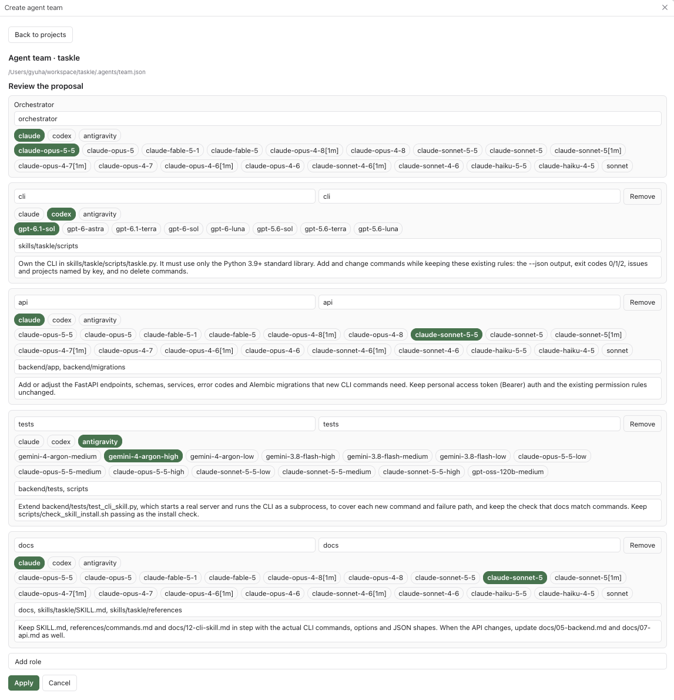
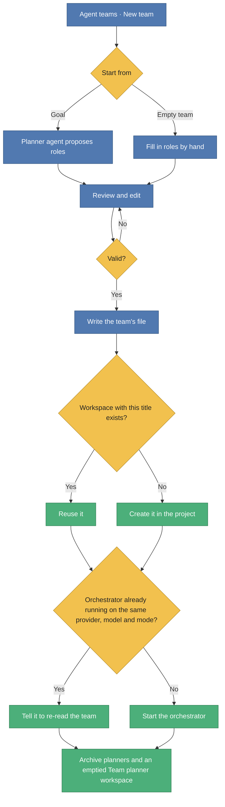

# Paseo Agent Team

A [Paseo](https://paseo.sh) plugin for project-scoped agent teams. Each role in a project has its own provider and model, and an orchestrator agent hands work to them. All roles run in the orchestrator's workspace, so a team uses one workspace.

For example, in a game project, design work can go to Codex, sound to Antigravity and gameplay code to Claude. You describe the goal once, review the proposed team, and from then on you talk to one orchestrator.



## Concepts

| Term | Meaning |
| --- | --- |
| **Project** | A repository registered in Paseo. A team belongs to one project. |
| **Workspace** | A Paseo workspace in that project. All of a team's roles work in the orchestrator's workspace. |
| **Role** | A name plus the provider, model, folders and instructions for one role, for example `design → codex/gpt-6.1-sol`. |
| **Orchestrator** | The agent that reads the team and delegates each part of a request to the role that owns it. |
| **Team definition** | One file per team in `.agents/teams/` at the project root, or the single file `.agents/team.json`. It is the source of truth for the team and is meant to be committed. |

The team lives in the repository rather than in plugin settings, so it is shared through git and readable by agents. Workspaces are matched by title, not by ID, so the same file works on any machine.

A project can run several teams, one per workspace. A team belongs to the workspace its orchestrator runs in, and the **Agent team** panel of a workspace shows that workspace's team. Teams never share a workspace: a team's orchestrator and roles all run in one workspace that belongs to that team only.

## Requirements

- Paseo 0.13.0 or later, with **Settings → Plugins → Enable plugins** turned on.
- At least one provider ready on the host. Check with `paseo provider ls` and `paseo provider models <provider>`.
- Paseo tools available to agents (the default). The orchestrator uses them, or the `paseo` CLI, to start and message other agents.

## Install

From a local checkout:

```bash
git clone https://github.com/gyuha/paseo-agent-team.git
cd paseo-agent-team
npm install
paseo plugin install "$(pwd)"
paseo plugin ls   # paseo-agent-team should be "running"
```

Or paste the absolute path of the checkout into **Settings → Plugins → Plugin source** in Paseo. Reload the Paseo window afterwards so the app picks up the plugin's UI.

## Usage

### 1. Create a team

Open a workspace in the project you want a team for, then:

1. Open the Command Center and run **Agent teams**, or open the **Agent team** workspace panel. A team created from a workspace runs its orchestrator in that workspace.

   Without an open workspace, for example on the New workspace screen, use **Agent teams** in the sidebar instead. It lists every project with its teams (orchestrator workspace, goal, role count) and any team-file errors. **Open team** opens that team's Agent team panel in its orchestrator workspace; when that workspace no longer exists, the row shows **Reconnect** in its place. **New team** on a project continues with step 2. The planner starts in an existing workspace of that project, or in a new `Team planner` workspace if it has none. After **Apply** you are taken to the orchestrator's workspace. The **All agents** tab next to **Teams** shows the dashboard controls once at the top, then filter chips **All N**, **Working N**, **Awaiting N** and **Idle N**. A chip shows only the agent trees (an orchestrator or solo agent with everything under it) that contain at least one agent in that state, whole, and hides project sections with no matching tree. The numbers count trees, so a tree with agents in several states counts under each of them. Awaiting covers agents waiting on a permission prompt or stopped on an error. Each project's agents are a dashboard tree under its title bar. Pressing a card opens that agent. These settings are not saved when you leave the screen. The sidebar's **Agent teams** row shows a badge with the number of unarchived agents that have a pending permission request or question, sub-agents included; agents stopped on an error are not counted, and the badge updates from agent events at most once a second. Pressing the row while the badge shows opens the screen on the **All agents** tab with the **Awaiting** filter selected, even when it is already open; without a badge it opens as before.
2. Describe the goal, for example `2D platformer game`, and press **Propose a team**. A planner agent looks at the repository and proposes roles using only the providers and models that are ready on this host. It takes a minute or two. You can leave the screen meanwhile: when you come back, the newest proposal for this workspace (or project) is picked up again, still running or ready to review. Proposing again or pressing **Cancel** in the review archives the earlier planner, so a cancelled proposal does not return.
3. Review the proposal. Every role runs in the orchestrator's workspace. You can rename roles, pick the provider and the model from searchable lists (press a field, type to filter, pick an item), set the folders each role owns, edit instructions, and add or remove roles. A role's folders field is hidden behind **Set folders** until you set folders, and is shown when the role already has folders. To have AI change the team, type a request under the role list, for example "add a docs role and move ui to another model", and press **Edit team with AI**. The request is treated as an edit of the existing team: a request that names a role, or whose work fits one, changes that role (its instructions, folders, provider or model, or name) instead of adding a role. A new role is added only when you ask for one or when no role fits, and a role is removed only when you ask or when it is merged into another. A planner agent titled `Team editor` reads the repository and proposes a revised team from the current draft. When it finishes, the revised team is applied to the draft straight away, and a notice lists the roles added, removed and changed (with the fields that changed), whether the orchestrator's provider or model changed, whether the goal changed, and any problems. **Undo** and **Redo** next to the button step back and forward through AI edits, one step per edit, and cancelling the review clears that history. The orchestrator's workspace never changes, and nothing is written to the team file until the editor's main **Apply** button. The `Team editor` agent is archived as soon as its revised team is read, so its tab closes. If it failed or stopped on a permission prompt, it stays open for you to look at and is archived with the other planners on **Apply**. A blank role added in the editor is named `role`, or `role#XXXX` (4 random uppercase hex characters) when that name is taken. Problems such as an unknown model are shown in red, and **Apply** stays disabled until they are fixed.

   Each role card shows the start of its instructions with **Edit instructions**, which opens a dialog with the full text. You can type in the dialog directly, or type an optional request and press **Improve with AI**: an instructions planner reads the repository and proposes a rewrite, shown in the dialog with **Apply suggestion** and **Discard**. **Save** only updates the draft; the team's file is written by **Apply**. The instructions planner is archived with the others on **Apply**, and until then it stays in the project.
4. Press **Apply**.

To skip the planner, press **Start with an empty team** and fill in the roles yourself.

Applying does four things in order. It writes the team's file (and, when needed, the allow rules described under Limitations), makes sure the orchestrator's workspace exists, starts the orchestrator, and cleans up the planners. A new team is written to `.agents/teams/<orchestrator workspace>.json`; a team that already has a file, including `.agents/team.json`, keeps it. An existing workspace with the same title is reused, and a missing one is created in the project. Applying again tells the team's running orchestrator to re-read the team instead of starting a second one; none is archived. Apply refuses a team that uses a workspace another team of the project already uses.

Cleanup archives every planner agent left in the project, including ones from proposals you cancelled. A `Team planner` workspace is archived too, but only when the team doesn't use it and no other agent is left in it. If cleanup fails, the team is still applied and the failure is shown as a warning.



### 2. Work through the orchestrator

Press **Open orchestrator** after applying, or find the agent titled **Orchestrator** in the orchestrator workspace. Talk to it in plain language:

> Redesign the title screen and add jump and coin sounds. Report back when both are done.

The orchestrator splits the request by role, starts each role's agent in the orchestrator's workspace with that role's provider and model (with `paseo run`, or with Paseo's `create_agent` tool for a role that uses the Auto Accept feature), and continues with an existing agent there, found by its `role=<name>` label, instead of starting a new one. Each agent it starts is titled `<role>#<id>` (for example `ui#ADB2`) and labelled `role=<role>`, so several agents of one role can be told apart. It waits for the results and summarizes what each role did. The role agents show up in the orchestrator's workspace in Paseo's sidebar, where you can watch them or talk to them directly.

```
Your request → Orchestrator splits it by role → each role's agent works in the orchestrator's workspace → Orchestrator waits and reports
```

### 3. Change the team

Either open the **Agent team** panel in the team's orchestrator workspace, press **Edit**, change the team and press **Apply**, or edit the team's file directly and press **Apply again** in the panel. The panel shows the file's path. The panel shows the current team and flags any provider or model the host can't run. If you rename the orchestrator's workspace in Paseo, the team shows as "workspace not found" on the **Agent teams** screen; press **Reconnect** on its row and pick the renamed workspace. That rewrites `orchestrator.workspace` in the team's file (and in an old `.agents/team.json` for the same workspace) to the workspace's new title. The file name and agents are not changed, and Reconnect refuses a workspace another team uses. If the orchestrator's workspace is gone rather than renamed, the Reconnect panel also offers **Start in a new workspace**, which runs the team like **Apply** with its saved file: it finds or creates the workspace named in the team file, starts the orchestrator and opens that workspace. The panel lists only the project's workspaces that no other team uses, since one workspace runs one team. When none is free, the panel says so and offers only that button and Cancel. To reset the orchestrator session with the same team, press **Reset session** next to **Apply again** (see Limitations).

To delete a team, press **Delete** on its row in the **Agent teams** screen and confirm. The delete archives the team's orchestrator, the role sessions labelled with its roles in its workspace (role names match case-insensitively), and any planner still proposing for its workspace, so a pending proposal does not come back. Agents in a workspace another team uses are left alone. No workspace is archived: Paseo workspaces carry no labels, so the plugin cannot tell one it created from one you made, and empty workspaces stay for you to archive. Only after every agent is archived are the team's file and any old `.agents/team.json` for the same orchestrator workspace deleted. If an agent can't be archived, no file is deleted and you can retry from the same row. If a file can't be deleted, a separate message says so. A file that is committed to git shows up as a deletion to commit.

```
Delete → archive the team's agents → delete the team's files
              ↓ an agent can't be archived
         no file is deleted; retry from the same row
                                       ↓ a file can't be deleted
                          a separate message says so
```

### 4. Watch the agents

The **Agent dashboard** panel (**에이전트 대시보드** in Korean) opens as a workspace tab or in the right sidebar next to Files and Changes, and shows the project's agents as a tree. An agent started by another agent appears under that agent, so role agents started by the orchestrator sit under it. Agents with no parent are roots and stay shown unless they are closed or archived, and roots without children are listed under **Solo agents**. Roles of the team that are not started yet appear under the newest orchestrator of the team's workspace as dimmed **Waiting** cards on a dashed line; a waiting card is replaced by the real card once an agent labelled with that role shows up in the team's workspace. Provider sub-agents, such as the sub-agents Claude Code starts with its Agent tool, appear as lighter **Sub-agent** cards (**하위 에이전트** in Korean) under the Paseo agent that spawned them, labelled with their sub-agent type. They can't be opened, since they are not Paseo agents. In **Brief** density they are collapsed into a **+N** badge under their parent that expands on press. With **Show closed** off, a role agent or sub-agent is shown only while it is running or has the **?** or **!** badge, when one of its descendants is, or when it is the newest finished one of its type (role, or sub-agent type) under the same parent. Older finished ones, and the agents under them, are hidden. An agent whose parent is not shown becomes a root and follows the same rule. With **Show closed** on, every agent is shown.

Use the **Density** toggle in the dashboard header, next to **Show closed**, to choose one of three levels. **Normal** is the default.

- **Brief**: a one-line pill with the provider logo, the role or title, a short model name and the status.
- **Normal**: a two-line card, 150px wide (140px in a narrow panel), with the logo, title and status, then `model · mode`.
- **Detailed**: the full card with caption, model, effort and mode chips, described below.

The choice is remembered per tab, like **Show closed**. Glow, arrival flash, signal dots and dashes are scaled to each level's node size.

With **Show closed** on, a closed or archived agent card, or a finished sub-agent card, shows a small × that hides it, together with the agents under it, from that dashboard tab. Cards that are running, need attention (**?** or **!**), or have a running agent under them have no ×. The header then shows **Restore hidden (N)**, which brings them all back. When there are closed agents to hide, the header also shows **Hide closed (N)** at the right, which hides every card that has a × at once. Hiding does not delete or archive anything in Paseo. The hidden list is remembered per dashboard tab, like **Show closed**, so the dashboard in a workspace tab and the one in the right sidebar keep separate lists. A Paseo agent whose session stopped on an error, such as a provider reporting insufficient funds, also shows a small **Archive** button. Pressing it archives that agent, so its tab closes and its card leaves the dashboard; it shows again only with **Show closed**. Cards waiting on a permission prompt, running cards, cards with a running agent under them, and provider sub-agents have no **Archive** button.


The Agent dashboard can also sit in the right sidebar while you work in the center of the window.


The capture shows the dashboard in **Detailed** density, with the orchestrator as the root card and four role agents under it: `release#449D`, `core#6057`, `ui#98BC` and `tester#B223`. All four start running, with red borders, glow and red dashed lines carrying moving signal dots from the orchestrator. `release` and `core` finish first and show ✓. `tester#B223` starts two Explore sub-agents, shown to its right as `density 테스트 실행` and `messages 테스트 실행`.

In **Detailed** density, each card shows the provider logo, the role or caption, the title, and the model, effort (thinking option) and permission mode chips. When an agent has no effort set, its effort chip shows the model's default effort from the provider, dimmed. The badge is a circled **?** when the agent is waiting for your answer to a permission prompt or question, **!** when it has stopped on an error, an amber pulsing dot while it runs, and ✓ when it has finished. Lines to running agents turn into animated red dashes with moving signal dots. An agent that is not running itself but has a running agent below it, such as an orchestrator waiting on its role agents, gets an amber border without the glow. Press a card to open that agent. Closed and archived agents are hidden unless **Show closed** is on.

### 5. Run another team in another workspace

Open the **Agent team** panel in a workspace that has no team yet and create one as in step 1. Its orchestrator runs in that workspace, and the team is written to its own file in `.agents/teams/`. Each team's orchestrator reads only its own file, so the teams don't change each other. The panel's create view also lists the project's other teams with a **Copy** button: it opens the review screen with that team's goal, roles and orchestrator provider and model, and this workspace as the orchestrator workspace. Nothing is written until **Apply**, and the copy stays independent of the original team. **Share** next to **Copy** instead adds this workspace to the team's file as a shared workspace and starts the team's orchestrator here; roles run in this workspace too. The team file stays in its home workspace. A shared team's panel says it is shared, and edits, AI edits and Apply from any of its workspaces change that one file. In a shared workspace, **Unshare** removes it from the list and closes only the orchestrator there. Deleting the team from the **Agent teams** screen removes it everywhere, and its confirmation lists the shared workspaces.
```
Workspace A panel → team A (.agents/teams/a.json) → orchestrator in A
Workspace B panel → team B (.agents/teams/b.json) → orchestrator in B
```

## Team definition format

`.agents/teams/<orchestrator workspace>.json`, or `.agents/team.json`:

```json
{
  "version": 1,
  "goal": "2D platformer game",
  "orchestrator": { "workspace": "orchestrator", "provider": "claude", "model": "claude-opus-5-5" },
  "roles": [
    {
      "name": "design",
      "provider": "codex",
      "model": "gpt-6.1-sol",
      "folders": ["src/ui", "assets/images"],
      "instructions": "Owns the UI and all visual assets."
    },
    {
      "name": "sound",
      "provider": "antigravity",
      "model": "gemini-4-argon-high",
      "folders": ["assets/audio"],
      "instructions": "Sound effects and music."
    }
  ]
}
```

| Field | Required | Notes |
| --- | --- | --- |
| `version` | yes | Always `1`. |
| `goal` | no | What the team is for. Shown to the orchestrator. |
| `orchestrator.workspace` | yes | Workspace title for the orchestrator. The team belongs to this workspace, and no two teams of a project may use the same one. |
| `orchestrator.provider`, `.model` | yes | Provider ID and model ID, as listed by `paseo provider models <provider>`. |
| `roles[]` | yes | At least one role. |
| `roles[].name` | yes | Unique, case-insensitive. |
| `roles[].provider`, `.model` | yes | Must be ready on the host when you apply. |
| `roles[].folders` | no | Folders the role owns. Empty means no limit. The orchestrator keeps roles inside them and runs overlapping work one after another. |
| `roles[].instructions` | no | Extra guidance for that role. |

## Language

The plugin's UI follows Paseo's app language. English is the default, and English, Korean, Japanese and Simplified Chinese UI text are included. Error messages from the daemon side are in English.

## Limitations

- A role's model applies to agents started by the orchestrator or this plugin. Agents you start yourself in the team's workspace from Paseo's own UI still use whatever model you pick there.
- Renaming a shared workspace detaches only that workspace. Teams still never share a workspace with another team, and sharing works only within one project.
- A team's file is matched to its workspace by `orchestrator.workspace`. Renaming that workspace in Paseo or in the file detaches the team from it until the two match again. Paseo has no rename event, so after renaming in Paseo, press **Reconnect** on the team's row (or edit `orchestrator.workspace` in the file) to reattach it.
- All roles run in one workspace, so they share one checkout and folder. Keep roles to separate folders, or have the orchestrator run overlapping work in sequence.
- A team file written by an older version may still list a workspace for a role. Roles still run in the orchestrator's workspace, but until the next Apply rewrites the file, those workspaces stay reserved for the team, and deleting the team also archives its role agents there. Apply removes them from the file. Workspaces created for roles by older versions are not archived, so archive them yourself.
- The planner, the orchestrator and the role agents start in the provider's reviewed auto mode when it has one: Codex's Auto-review (`auto-review`), otherwise an `auto` mode such as Claude's Auto mode (`auto`), otherwise any other mode whose id or label has a word starting with `auto`, such as `auto_edit` or `Auto accept`. Only a provider with none of these uses its unattended mode: the one marked unattended, otherwise the one Paseo marks dangerous, such as Antigravity's Full access. A provider with none of these modes but an Auto Accept feature, such as Cursor, starts them with that feature on instead. Otherwise the planner and the orchestrator use the default mode, and a role's agent uses its provider's default mode when that is one of its modes, otherwise its first mode. The unattended mode keeps running without asking you; Auto mode and Auto-review route permission requests through an automatic reviewer instead. The planner is told not to change files but is not technically prevented from doing so.
- Auto Accept is not a reviewed mode. Cursor offers `auto_accept` as a feature toggle rather than a mode, and the plugin turns it on only when the provider has no auto, unattended or dangerous mode. An agent started with it approves every permission prompt the provider sends, with no automatic reviewer, as Antigravity's `full-access` does, unlike Claude's `auto` mode or Codex's `auto-review`. If the plugin can't read a provider's features, the agent starts in the mode it would otherwise get.
- A role that uses the Auto Accept feature is started with Paseo's `create_agent` tool, because `paseo run` cannot set features. The orchestrator needs that MCP tool. If it can't use the tool or the start is denied, it reports the role, provider, mode and features as blocked and does not fall back to `paseo run`.
- An orchestrator in Claude's Auto mode has its tool calls checked by Claude's automatic reviewer, which can deny starting an agent in an unattended mode such as Antigravity's `full-access`, the only mode Antigravity has. The orchestrator is told to use each role's mode as given, never to swap in another mode or provider, and to report a denied start to you instead. So when the orchestrator runs on Claude and a role's chosen mode is unattended, Apply adds the narrow allow rule `Bash(paseo run *)` to the project's `.claude/settings.local.json`, which Auto mode honours without asking its reviewer. This lets the orchestrator start any agent with `paseo run` without review. When a role uses the Auto Accept feature, Apply (and Reset session) adds `mcp__paseo__create_agent` to the same file in the same way, so the orchestrator can start that role with Paseo's `create_agent` tool without review. Remove the rules to undo them. Claude Code ignores that file in git only when Claude Code itself created it, so check that you don't commit it. An orchestrator that was already running may need to be restarted to pick up the rule.
- The `<role>#<id>` agent title is an instruction in the orchestrator's prompt, not something the plugin enforces, so an agent may be titled differently. An orchestrator keeps the instructions it started with until its session is reset with **Reset session**.
- Paseo's sidebar puts a workspace it hasn't seen yet at the top of its project, so a workspace that Apply creates appears there. A workspace you already have keeps its place. The plugin cannot set the sidebar order.
- Sending `/clear` in the orchestrator's chat makes Paseo archive that agent and start a new one in the same workspace with no labels and no instructions, so the plugin no longer treats it as the team's orchestrator and it loses the team's instructions. Use **Reset session** in the team panel instead: after a confirmation it archives the labelled orchestrator and starts a new one with the same team, provider, model, mode and instructions, read from the team file, and role sessions are kept. Close the agent that `/clear` created yourself.
- Very long workspace or agent lists are read as a single page. On hosts with a lot of workspaces, an existing workspace could be missed and created again, and the agent dashboard can miss agents beyond that page. Team delete has the same gap: team agents beyond the page are not archived.
- On Paseo hosts without client navigation, the agent dashboard cards are not pressable.
- Sub-agents started before the dashboard opened are found in the last 200 timeline items of each unarchived agent in the project. Opening the dashboard reads one such page per agent, so a project with many agents makes many requests.
- The plugin cannot delete agents. Paseo's plugin API offers only archive (checked up to `@getpaseo/client` 0.15.2), so the dashboard's × can only hide an agent in that tab, and the agent stays in Paseo.
- A sub-agent found in that window takes its status from the timeline and can read finished while a background sub-agent is still running, until its next activity arrives.
- In the narrow right sidebar, when the panel is too narrow for the whole tree, the orchestrator card shrinks to its provider icon and model name. If the tree still does not fit, it scrolls horizontally with the scrollbar at the bottom of the panel, so role cards may be off-screen until you scroll.

## Development

```bash
npm install            # .npmrc sets legacy-peer-deps, which works around an npm 10.9 resolver crash
npm run typecheck
npm test               # unit tests
PASEO_E2E=1 npx vitest run tests/daemon.e2e.test.ts   # against the local daemon
paseo plugin reload paseo-agent-team
paseo plugin logs paseo-agent-team
```

The end-to-end test starts real agents (a planner and an orchestrator) in a temporary project under the system temp folder, so it costs tokens. It connects to `ws://127.0.0.1:6767/ws` unless `PASEO_URL` is set.

Layout: `shared/` holds the team schema, validation, prompts, RPC contracts and UI text, and is compiled into both sides. `server/` holds the daemon-side RPC handlers. `client/` holds the panel. `tests/` holds the Vitest suites.

## License

This project is released under the [MIT License](LICENSE).
